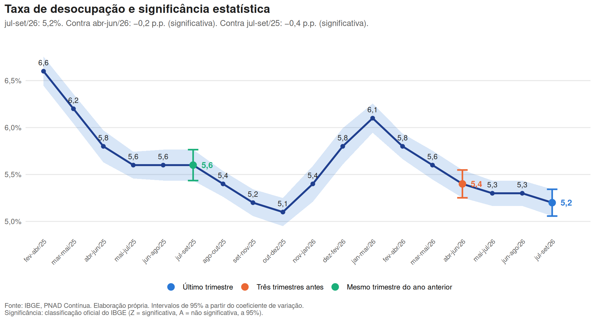
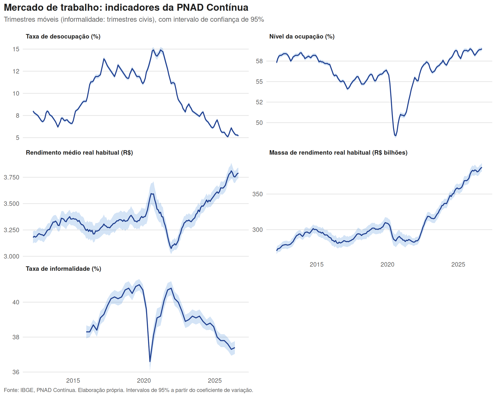

# Monitor do mercado de trabalho: trimestre móvel jul-set/26

*Atualizado automaticamente após a divulgação da PNAD Contínua pelo IBGE.*

## Destaques

- **Taxa de desocupação, jul-set/26: 5,2%** (intervalo de 95%: 5,1% a 5,3%). Contra três trimestres móveis antes: −0,2 p.p., **significativa**. Contra o mesmo período do ano anterior: −0,4 p.p., **significativa**.
- **Nível da ocupação, jul-set/26: 59,0%** (intervalo de 95%: 58,8% a 59,2%). Contra três trimestres móveis antes: +0,2 p.p., **significativa**. Contra o mesmo período do ano anterior: +0,2 p.p., **não significativa**.
- **Rendimento médio real habitual, jul-set/26: R$ 3.790** (intervalo de 95%: R$ 3.738 a R$ 3.842). Contra três trimestres móveis antes: +1,0%, **não significativa**. Contra o mesmo período do ano anterior: +3,6%, **significativa**.
- **Massa de rendimento real habitual, jul-set/26: R$ 387,5 bilhões** (intervalo de 95%: R$ 381,4 bilhões a R$ 393,6 bilhões). Contra três trimestres móveis antes: +1,5%, **significativa**. Contra o mesmo período do ano anterior: +4,7%, **significativa**.
- **Taxa de informalidade, 2º tri/26: 37,4%** (intervalo de 95%: 37,0% a 37,8%). Contra o trimestre anterior: +0,1 p.p., **não significativa**. Contra o mesmo período do ano anterior: −0,4 p.p., **não significativa**.

## Painel de sinais

Variações em relação a três trimestres antes (períodos sem sobreposição) e ao mesmo período do ano anterior. Z: variação estatisticamente significativa a 95%; A: sem significância. Classificação oficial do IBGE.

| Indicador | Último | Contra 3 trimestres antes | Sinal | Contra 1 ano antes | Sinal |
|---|---:|---:|:---:|---:|:---:|
| Taxa de desocupação | 5,2% | −0,2 p.p. | Z | −0,4 p.p. | Z |
| Nível da ocupação | 59,0% | +0,2 p.p. | Z | +0,2 p.p. | A |
| Rendimento médio real habitual | R$ 3.790 | +1,0% | A | +3,6% | Z |
| Massa de rendimento real habitual | R$ 387,5 bilhões | +1,5% | Z | +4,7% | Z |
| Taxa de informalidade | 37,4% | +0,1 p.p. | A | −0,4 p.p. | A |

## Sobreposição das bandas não é teste

Em toda a série, quantas variações classificadas como significativas pelo IBGE teriam passado despercebidas por quem olhasse só a sobreposição dos intervalos:

| Indicador | Comparação | Períodos | Significativas (Z) | Significativas com bandas sobrepostas |
|---|---|---:|---:|---:|
| Taxa de desocupação | três trimestres móveis antes | 172 | 148 | 33 (22%) |
| Taxa de desocupação | um ano antes | 163 | 143 | 12 (8%) |
| Nível da ocupação | três trimestres móveis antes | 172 | 139 | 51 (37%) |
| Nível da ocupação | um ano antes | 163 | 118 | 20 (17%) |
| Rendimento médio real habitual | três trimestres móveis antes | 172 | 69 | 65 (94%) |
| Rendimento médio real habitual | um ano antes | 163 | 107 | 51 (48%) |
| Massa de rendimento real habitual | três trimestres móveis antes | 172 | 73 | 67 (92%) |
| Massa de rendimento real habitual | um ano antes | 163 | 134 | 62 (46%) |
| Taxa de informalidade | trimestre anterior | 42 | 17 | 14 (82%) |
| Taxa de informalidade | um ano antes | 39 | 29 | 7 (24%) |

Em nenhum caso bandas separadas coincidiram com variação não significativa: a regra visual é conservadora. Ela não aponta mudança onde não há, mas deixa de ver boa parte das que há. Intervalos calculados a partir das estimativas e dos coeficientes de variação publicados, que são arredondados.

